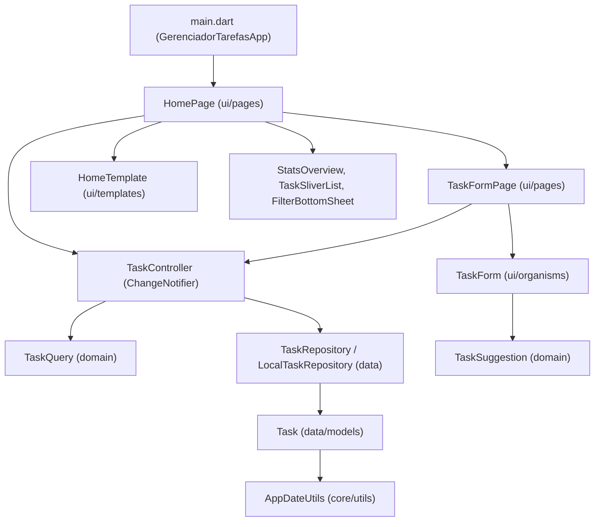

# Gerenciador de Tarefas Inteligente (GTI)

Aplicativo multiplataforma desenvolvido em **Flutter** para gerenciamento de tarefas com classificação automática de metadados, ordenação inteligente por urgência, busca normalizada e persistência local offline.

O projeto foi estruturado combinando **separação em camadas** (`core`, `data`, `domain`, `controllers`, `ui`) e **Atomic Design** na camada de interface, priorizando código limpo, baixo acoplamento e testabilidade.

---

## Sumário

- [Funcionalidades](#funcionalidades)
- [Arquitetura do Projeto](#arquitetura-do-projeto)
- [Decisões Técnicas](#decisões-técnicas)
- [Tecnologias e Ambiente](#tecnologias-e-ambiente)
- [Como Executar e Testar](#como-executar-e-testar)
- [Estrutura de Pastas](#estrutura-de-pastas)
- [Roadmap de Evoluções](#roadmap-de-evoluções)

---

## Funcionalidades

- **CRUD Completo de Tarefas:** criação, edição, conclusão rápida e exclusão (via *swipe* no card ou pelo formulário), com diálogo de confirmação para ações destrutivas e `SnackBar` com opção **"Desfazer"**.
- **Categorização e Priorização:**
  - **Categorias:** Trabalho, Estudo, Pessoal, Saúde, Finanças e Outros.
  - **Prioridades:** Alta, Média e Baixa (com sinalização visual dedicada).
- **Recursos Inteligentes:**
  - **Sugestão Automática (`TaskSuggestion`):** ao digitar o título de uma nova tarefa, o app sugere categoria e prioridade alta com base em palavras-chave (ex.: *"Pagar boleto urgente"* → **Finanças** / **Alta**), respeitando alterações manuais do usuário.
  - **Ordenação Inteligente (`TaskSort.inteligente`):** organiza automaticamente a lista por: `pendentes → atrasadas → maior prioridade → vencimento mais próximo → mais recentes`. Também oferece ordenação por Prioridade, Vencimento, Mais recentes e Alfabética (A–Z).
- **Busca e Filtros Combinados:**
  - Busca em tempo real com *debounce* (220 ms) e normalização de acentos em título, descrição e categoria (ex.: buscar `reuniao` encontra `Reunião`).
  - Painel modal (`FilterBottomSheet`) para filtrar por **Status**, **Categoria** e **Prioridade**.
- **Prazos e Estatísticas:**
  - Datas de vencimento com rótulos relativos (`Hoje`, `Amanhã`, `Ontem`, `Atrasada X dias`, `Em X dias`) e destaque visual para tarefas em atraso.
  - Painel superior (`StatsOverview`) com contagem de tarefas **Pendentes**, **Concluídas** e **Atrasadas**.
- **Persistência Local Offline:** armazenamento automático no dispositivo com `shared_preferences`.

---

## Arquitetura do Projeto

A aplicação separa regras de negócio puras, acesso a dados, gerenciamento de estado e componentes visuais:



### Responsabilidade das Camadas

| Camada | Diretório | Responsabilidade |
| :--- | :--- | :--- |
| **Core** | `lib/core/` | Tokens de design (`AppColors`), tema Material 3 (`AppTheme`) e utilitários de data (`AppDateUtils`). |
| **Data** | `lib/data/` | Modelo imutável `Task` (serialização JSON e igualdade por valor) e repositório `LocalTaskRepository` com contrato abstrato `TaskRepository`. |
| **Domain** | `lib/domain/` | Regras de negócio puras em Dart (sem dependência do Flutter): `TaskQuery` (filtros/ordenação/normalização) e `TaskSuggestion` (heurística de sugestão). |
| **Controllers** | `lib/controllers/` | `TaskController` (`ChangeNotifier`) centraliza estado em memória, métricas, filtros e sincronização com o repositório. |
| **UI (Atomic Design)** | `lib/ui/` | Componentes divididos em `atoms`, `molecules`, `organisms`, `templates`, `pages` e helpers visuais em `ui/core/`. |

---

## Decisões Técnicas

- **Atomic Design na Interface:** componentes pequenos e reutilizáveis (`AppButton`, `AppChoiceChip`, `TaskCheckbox`, `CategoryTag`, `PriorityBadge`) compõem moléculas (`SearchField`, `StatTile`, `FilterButton`, `ResultsHeader`) e organismos (`TaskCard`, `TaskForm`, `FilterBottomSheet`), mantendo os templates livres de regra de negócio.
- **Desacoplamento Visual de Domínio:** ícones e cores de `TaskCategory` e `TaskPriority` ficam isolados em `lib/ui/core/task_visuals.dart` via *extensions*, mantendo `Task` livre de dependências de UI.
- **Design Responsivo:** `ContentConstraint` limita a largura útil a `720 px`, garantindo boa legibilidade tanto em smartphones quanto em telas desktop/tablet.
- **Resiliência e Prevenção de Bugs:**
  - Cálculo de diferença de dias em **UTC** (`AppDateUtils.daysFromToday`) para evitar distorções em transições de horário de verão.
  - Leitura item a item no `LocalTaskRepository` para que um registro JSON corrompido não descarte as demais tarefas válidas.
  - Injeção opcional de `TaskRepository` no `TaskController` e de `TaskController` na `HomePage`, facilitando testes unitários e de widget.

---

## Tecnologias e Ambiente

- **Linguagem / Framework:** Dart `^3.3.0` e Flutter (Material 3)
- **Localização:** `flutter_localizations` (`pt_BR`)
- **Persistência:** `shared_preferences: ^2.2.2`
- **Qualidade de Código:** `flutter_lints: ^3.0.0` (`prefer_const_constructors`, `prefer_const_literals_to_create_immutables`)
- **Plataformas configuradas:**
  - **Android:** Java 17, Gradle 9.3.1, Android Gradle Plugin 9.1.0, Kotlin 2.4.0
  - **iOS:** projeto Xcode configurado em `ios/` (`IPHONEOS_DEPLOYMENT_TARGET = 15.0`, compatível com `shared_preferences_foundation`)
  - **Linux Desktop:** suporte nativo via CMake

---

## Como Executar e Testar

### Pré-requisitos

- Flutter SDK (canal `stable`, compatível com Dart `^3.3.0`)
- Android SDK / emulador ou dispositivo físico (ou toolchain desktop Linux)
- Para build/execução em **iOS**: ambiente **macOS** com **Xcode** e **CocoaPods** instalados

### Comandos

```bash
# 1. Validar o ambiente
flutter doctor

# 2. Instalar as dependências
flutter pub get

# 3. Verificar análise estática (lint)
flutter analyze

# 4. Executar os testes automatizados
flutter test

# 5. Executar o aplicativo (Android, Linux ou iOS no macOS)
flutter run
```

### Build por Plataforma

```bash
# Android (APK de release)
flutter build apk --release

# Linux Desktop
flutter build linux --release

# iOS (executar em macOS com Xcode configurado)
flutter build ios --release
```

### Cobertura de Testes (`test/widget_test.dart`)

A suíte atual contém **7 testes automatizados**, cobrindo:
1. Serialização, desserialização e igualdade por valor de `Task`.
2. Fluxo completo de CRUD, filtros combinados, busca sem acento e persistência no `TaskController`.
3. Tolerância a falhas do `LocalTaskRepository` ao encontrar item JSON corrompido.
4. Garantia de encerramento do estado `isLoading` em `TaskController.load` diante de exceções.
5. Inferência de categoria e prioridade em `TaskSuggestion.fromTitle`.
6. Cálculo de rótulos relativos e datas em `AppDateUtils`.
7. Teste de widget validando a renderização do estado vazio na `HomePage`.

---

## Estrutura de Pastas

```text
android/             # Projeto nativo Android (Gradle / Kotlin)
ios/                 # Projeto nativo iOS (Xcode / Swift)
linux/               # Projeto nativo Linux Desktop (CMake)
lib/
├── main.dart
├── core/
│   ├── theme/
│   │   ├── app_colors.dart          # Paleta editorial e tokens semânticos
│   │   └── app_theme.dart           # Configuração global do tema Material 3
│   └── utils/
│       └── date_utils.dart          # Formatação e cálculos de data em UTC
├── data/
│   ├── models/
│   │   └── task.dart                # Modelo Task + enums TaskCategory e TaskPriority
│   └── repositories/
│       └── task_repository.dart     # Interface TaskRepository e LocalTaskRepository
├── domain/
│   ├── task_query.dart              # Filtros, busca normalizada e 5 ordenações
│   └── task_suggestion.dart         # Sugestão automática por palavras-chave
├── controllers/
│   └── task_controller.dart         # Estado reativo (ChangeNotifier) e métricas
└── ui/
    ├── core/
    │   ├── app_feedback.dart        # Diálogos de confirmação e SnackBar com Desfazer
    │   └── task_visuals.dart        # Ícones e cores para categorias e prioridades
    ├── atoms/                       # AppButton, AppChoiceChip, AppTextField, TaskCheckbox...
    ├── molecules/                   # SearchField, FilterButton, ResultsHeader, StatTile...
    ├── organisms/                   # TaskCard, TaskSliverList, TaskForm, StatsOverview...
    ├── templates/                   # HomeTemplate, FormTemplate
    └── pages/                       # HomePage, TaskFormPage
test/
└── widget_test.dart                 # Testes unitários e de widget
```